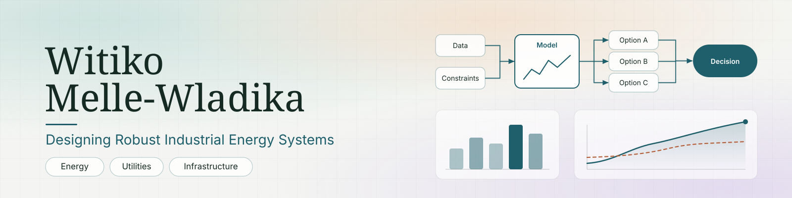

## Hi, I'm Witiko 👋

I design **robust, practical energy systems for industry**. My background is **energy, utilities and infrastructure**, with **10 years of hands-on experience** in heat pumps, ventilation systems, chillers and the plants around them: from design and commissioning to day-to-day operation.

Alongside that, I'm doing a **PhD at CTU Prague** on energy system simulation and investment planning, focused on decisions that hold up under uncertainty: *what to build, and when*.

## What I work on

- ⚙️ **Industrial energy & utilities**: heat pumps, chillers, steam and heating networks, ventilation
- 🧱 **Robust system design**: sound sizing, reliable operation, solutions that work in the real plant
- 📈 **Investment planning under uncertainty**: simulation of industrial heat supply, including the path to lower emissions
- 🛠️ **Tools**: Python, simulation models, and small apps that make engineering work easier

## Share & learn

I explain how real plants are designed and sized, with calculations and practical tips, on **YouTube** and **Instagram** under *energy.engineering.excellence*.

Outside of engineering: volunteering in civil protection and fire safety, and photography.
